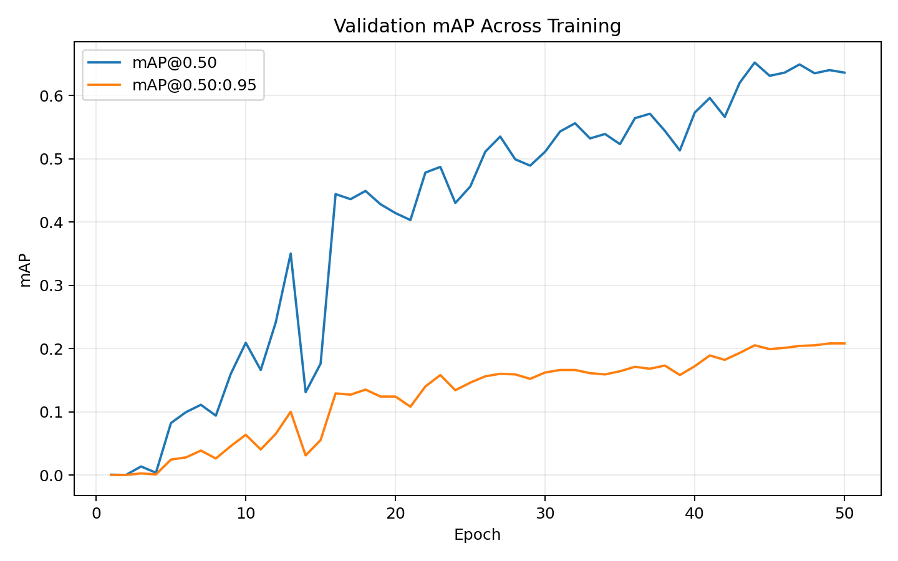
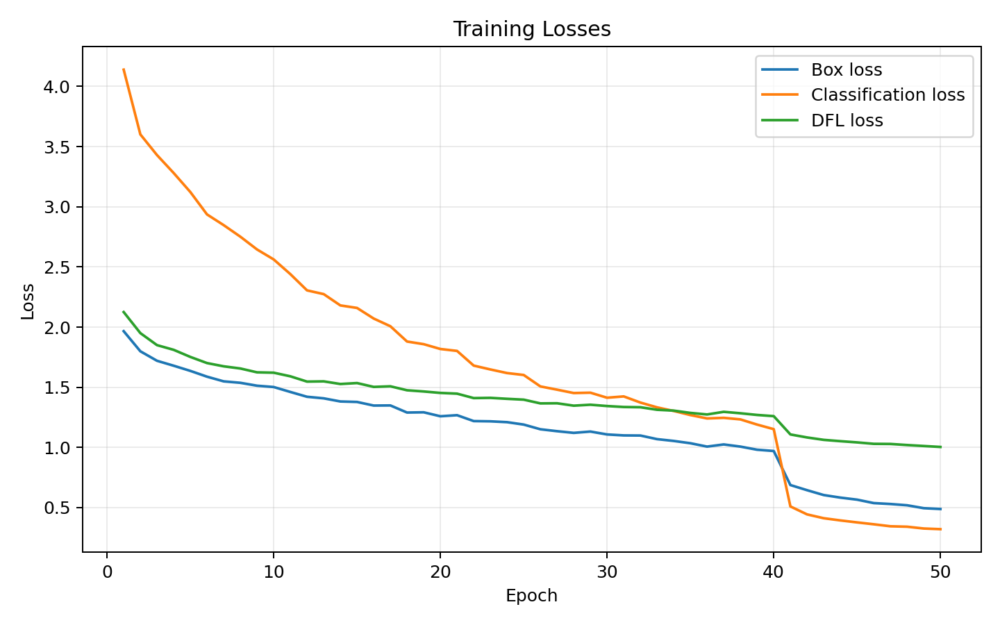
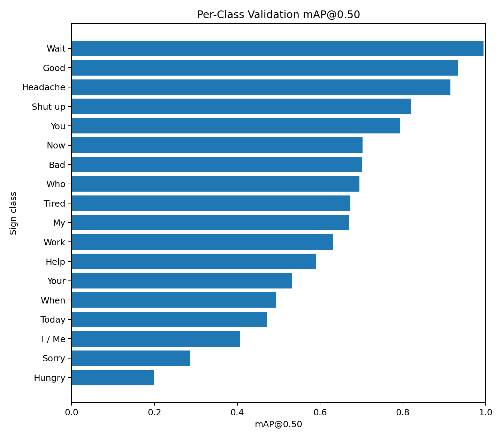
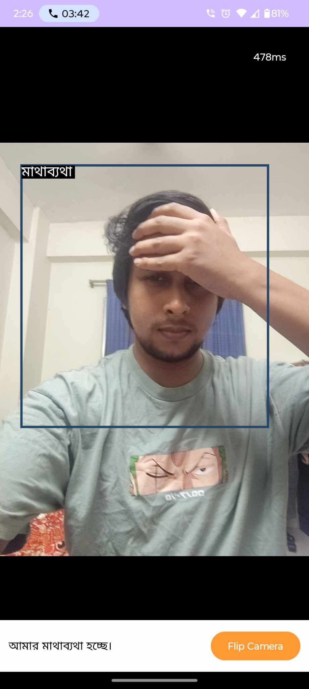
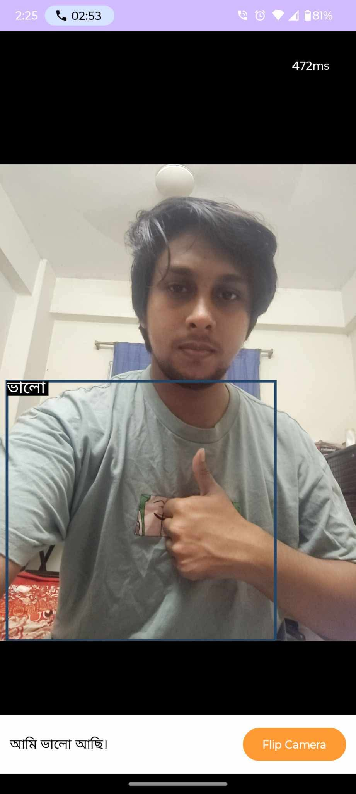

# BdSL Vision — Bangla Sign Recognition & Edge ML

An end-to-end computer vision pipeline for recognizing **18 Bangla Sign Language (BdSL) word classes**. The project covers dataset preparation, annotation validation and repair, YOLOv8s fine-tuning, class-level evaluation, TensorFlow Lite export, and on-device Android inference.

**4,139 annotated samples · 18 classes · YOLOv8s · mAP@0.50 0.639 · TFLite edge deployment**

## What this project covers

| Area | Work |
|---|---|
| **Dataset engineering** | Image-label pairing, YOLO annotation preparation, integrity checks, and invalid bounding-box repair |
| **Model engineering** | YOLOv8s transfer learning on 18 BdSL classes with a reproducible 80/20 split |
| **Evaluation** | Precision, recall, mAP, training curves, and per-class analysis |
| **Edge deployment** | PyTorch checkpoint exported to TensorFlow Lite and validated in an Android camera pipeline |

## Pipeline

```mermaid
flowchart LR
    A[Raw BdSL images] --> B[18-class curation]
    B --> C[YOLO annotations]
    C --> D[Validation & repair]
    D --> E[80/20 train-validation split]
    E --> F[YOLOv8s fine-tuning]
    F --> G[Evaluation]
    G --> H[best.pt]
    H --> I[TFLite FP16 export]
    I --> J[Android edge inference]
```



## Dataset engineering

The source BdSL images were prepared for an object-detection workflow rather than used as a ready-made training set. The pipeline pairs images with YOLO labels, verifies image/annotation correspondence, and constrains invalid normalized bounding-box values before training.

- **Annotated image-label pairs:** 4,139
- **Training split:** 3,311
- **Validation split:** 828
- **Target classes:** 18 — see [`classes.txt`](classes.txt)
- **Split seed:** 42

## Model training

| Configuration | Value |
|---|---|
| Model | YOLOv8s |
| Epochs | 50 |
| Input size | 416 × 416 |
| Batch size | 32 |
| Optimizer | AdamW |
| Initial learning rate | 0.01 |
| Early-stopping patience | 10 |

The preserved training workflow is available in [`notebooks/bdsl_vision_training.ipynb`](notebooks/bdsl_vision_training.ipynb).

## Results

The best checkpoint was evaluated on the **828-image validation split**.

| Metric | Score |
|---|---:|
| Precision | **0.734** |
| Recall | **0.729** |
| mAP@0.50 | **0.639** |
| mAP@0.50:0.95 | **0.208** |

### Training progress





### Per-class performance



Performance varies substantially across the 18 signs. `অপেক্ষা করো`, `ভালো`, and `মাথাব্যথা` are among the stronger classes, while `ক্ষুধার্ত` and `দুঃখিত` remain more challenging.

See the full breakdown in [`results/per_class_metrics.md`](results/per_class_metrics.md).

## Edge deployment

The selected PyTorch checkpoint was exported to TensorFlow Lite for local inference. This allowed the detector to be tested outside the notebook in an Android camera pipeline without requiring cloud inference.

<table>
  <tr>
    <td align="center"><br/><code>ভালো</code> → আমি ভালো আছি।</td>
    <td align="center"><br/><code>মাথাব্যথা</code> → আমার মাথাব্যথা হচ্ছে।</td>
  </tr>
</table>

The Android application is used here as a **deployment testbed**; the primary focus of this repository is the dataset, model, evaluation, and edge-ML pipeline.

## Model artifacts

The main trained artifacts are kept separate from normal Git history:

- `best.pt` — trained YOLOv8s checkpoint
- `best_float16.tflite` — FP16 TensorFlow Lite export
- `best_float32.tflite` — FP32 TensorFlow Lite export

See [`models/README.md`](models/README.md).

## Repository structure

```text
.
├── assets/                 # Android deployment screenshots
├── models/                 # Model artifact documentation
├── notebooks/              # Preserved training workflow
├── results/
│   ├── training/           # Recovered training curves
│   ├── metrics.md
│   ├── per_class_metrics.md
│   └── per_class_map50.png
├── classes.txt
├── requirements.txt
└── README.md
```

## Limitations

- The detector covers **18 predefined signs**, not the full BdSL vocabulary.
- Current evaluation uses an **image-level 80/20 split** rather than a signer-independent held-out test set.
- Performance differs significantly between classes.
- The current detector operates on frame-level visual signs; continuous sign-language understanding would require temporal modeling.
- Phrase generation in the mobile prototype is rule-based rather than learned language translation.

## Next steps

- Add signer-independent evaluation and broader test data.
- Benchmark FP32 vs FP16 model size and device latency.
- Extend the vocabulary and investigate temporal/continuous sign recognition.
- Add a lightweight browser demo for testing the trained model.

## Demo

A small browser-based inference demo is planned. It will be presented as a way to **test the trained model**, not as the main contribution of the project.
