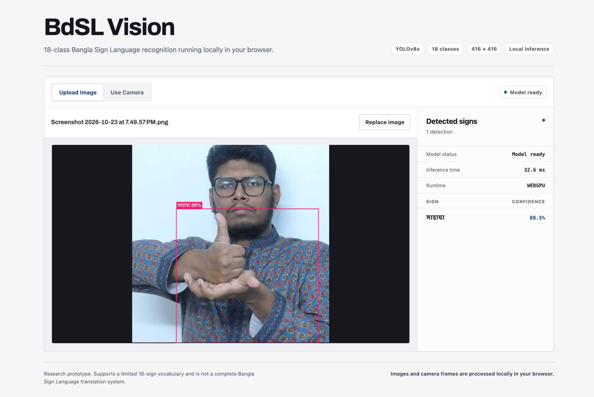

# BdSL Vision — Bangla Sign Recognition & Edge ML

End-to-end computer vision pipeline for Bangla Sign Language recognition: dataset engineering, annotation validation, YOLOv8s fine-tuning, evaluation, and multi-runtime edge deployment.

**4,139 annotated samples · 18 classes · YOLOv8s · mAP@0.50 0.639**

[Live demo](https://banglahandsignrecognition.netlify.app) · [Training notebook](notebooks/bdsl_vision_training.ipynb) · [Validation results](results/metrics.md) · [Per-class metrics](results/per_class_metrics.md)

## Key numbers

| Item | Value |
|---|---:|
| Annotated image-label pairs | 4,139 |
| Train / validation split | 3,311 / 828 |
| Classes | 18 |
| Input resolution | 416 × 416 |
| Training epochs | 50 |

## Project scope

This repository covers four connected parts of an applied edge-ML workflow:

- **Dataset engineering:** class selection, image-label pairing, YOLO annotation checks, repair, and deterministic splitting.
- **Model engineering:** transfer learning from a YOLOv8s checkpoint with a documented training entry point.
- **Evaluation:** aggregate and per-class metrics plus recovered training curves.
- **Edge deployment:** export and integration for Android with TensorFlow Lite and for browsers with ONNX.

It is a detector for a constrained 18-sign vocabulary, not a complete Bangla Sign Language translator.

## Architecture

```text
Raw BdSL images + YOLO labels
              │
              ▼
 Pairing → validation/repair → deterministic 80/20 split
              │
              ▼
       YOLOv8s fine-tuning → evaluation → best.pt
                                            ├── TFLite FP16 → Android
                                            └── ONNX FP16   → Browser
```

## Dataset engineering

The source BdSL data required preparation for object detection. The workflow selected 18 classes, matched images and labels by filename stem, checked YOLO rows and class IDs, clamped invalid normalized bounding-box values when explicitly requested, and produced a seed-42 image-level train/validation split. The resulting experiment used 3,311 training pairs and 828 validation pairs.

The complete external dataset is not distributed here. Use and redistribution must follow the original dataset's terms.

## Model training

| Configuration | Value |
|---|---|
| Initial checkpoint | `yolov8s.pt` |
| Epochs | 50 |
| Input size | 416 × 416 |
| Batch size | 32 |
| Optimizer | AdamW |
| Initial learning rate | 0.01 |
| Early-stopping patience | 10 |
| Workers | 2 |
| Seed | 42 |

The historical Colab experiment, including its original outputs, remains preserved in [the training notebook](notebooks/bdsl_vision_training.ipynb). Although that experiment used a misleading legacy run-directory name, its code initialized and trained YOLOv8s; new scripts use the unambiguous name `bdsl_yolov8s`. The workflow pins the notebook's recorded Ultralytics version for export compatibility.

## Results

Evaluation used the 828-image validation split.

| Metric | Score |
|---|---:|
| Precision | 0.734 |
| Recall | 0.729 |
| mAP@0.50 | 0.639 |
| mAP@0.50:0.95 | 0.208 |


## Per-class performance

Performance varies materially across the 18 classes; aggregate metrics should not be read as uniform class performance.


See [the complete per-class table](results/per_class_metrics.md).

## Edge deployment

```text
models/best.pt
├── TensorFlow Lite FP16 → Android deployment testbed
└── ONNX FP16            → local browser inference
```

The final PyTorch checkpoint, TensorFlow Lite FP16 model, and browser ONNX model are included in the repository.

The Android interface served as deployment validation rather than the primary contribution.

<table>
  <tr>
    <td align="center"><br><code>ভালো</code></td>
    <td align="center"><br><code>মাথাব্যথা</code></td>
  </tr>
</table>

## Browser deployment

The [live browser demo](https://banglahandsignrecognition.netlify.app) loads `demo/public/models/bdsl-yolov8s.onnx` and performs inference locally in the browser with no backend. It supports image upload and camera input, reports Bengali labels, confidence, inference latency, and the selected runtime/device, and includes a research-prototype disclaimer.



```bash
npm --prefix demo install
npm --prefix demo run build
```

## Repository structure

```text
.
├── assets/                  # Android and browser deployment screenshots
├── configs/data.example.yaml
├── demo/                    # React/Vite local ONNX inference demo
│   └── public/models/bdsl-yolov8s.onnx
├── models/
│   ├── README.md
│   ├── best.pt
│   └── best_float16.tflite
├── notebooks/bdsl_vision_training.ipynb
├── results/
│   ├── metrics.md
│   ├── per_class_metrics.md
│   ├── per_class_map50.png
│   └── training/
├── src/
│   ├── export_model.py
│   ├── prepare_dataset.py
│   ├── train.py
│   └── validate_annotations.py
├── classes.txt
├── netlify.toml
└── requirements.txt
```

## Reproduction

Install the Python workflow dependencies:

```bash
python -m venv .venv
source .venv/bin/activate
python -m pip install -r requirements.txt
```

Validate and prepare data without notebook-specific paths:

```bash
python src/validate_annotations.py \
  --images data/raw/images \
  --labels data/raw/labels \
  --classes classes.txt

python src/prepare_dataset.py \
  --images data/raw/images \
  --labels data/raw/labels \
  --output data/processed \
  --train-ratio 0.8 \
  --seed 42
```

Copy `configs/data.example.yaml`, adjust its dataset path, and explicitly start training only when desired:

```bash
python src/train.py --data configs/data.yaml --project runs/train --name bdsl_yolov8s
```

Exports also run only when explicitly requested:

```bash
python src/export_model.py models/best.pt --format tflite
python src/export_model.py models/best.pt --format onnx
```

## Limitations

- Only 18 predefined signs are supported; this is not a complete BdSL translation system.
- Current evaluation uses an image-level 80/20 split. Signer-independent test evaluation remains future work.
- Per-class performance varies significantly.
- Frame-level detection does not solve continuous sign-language translation.
- Phrase generation in the Android prototype was rule-based.

## Future work

- Add signer-independent evaluation and a held-out test set.
- Expand the vocabulary and collect more balanced data.
- Evaluate temporal models for continuous signing.
- Benchmark PyTorch, TensorFlow Lite FP16, and ONNX across representative edge devices.

## Attribution and data

The Android shell was adapted from an existing open-source YOLO Android implementation. This repository's contribution is dataset engineering, model development and evaluation, model export, and integration. **TODO:** add the exact upstream Android repository URL and license after they are verified.

The dataset is not claimed as original work and is not bundled. Add the verified dataset citation and license before redistributing source data.

## License

No repository-wide license is currently declared because compatibility with the upstream dataset and Android sources has not yet been verified. Model and data redistribution must follow the applicable original licenses.
